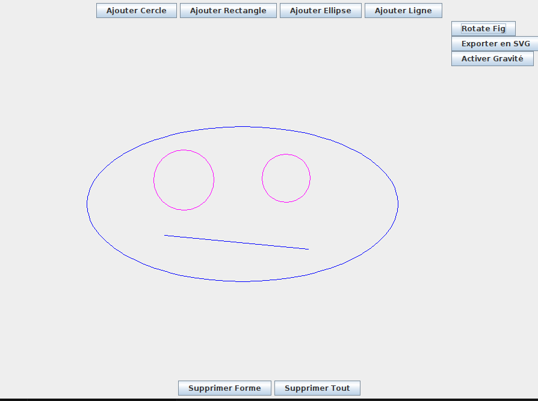

# Projet Java – Figures Géométriques, SVG et JUnit avec Ant

Ce projet Java a été réalisé sur deux jours dans le but de découvrir les outils **Apache Ant** et **JUnit** tout en testant nos connaissances en Java et notre compréhension de la POO. Il met en œuvre plusieurs fonctionnalités autour de la manipulation de figures géométriques, de leur visualisation et de tests automatisés.

## 📦 Structure du projet

- `src/` : code source Java
- `output/` : fichiers SVG exportés
- `docs/javadoc/` : documentation Javadoc aprés génération
- `libs/` : bibliothèque JUnit utilisée
- `build.xml` : fichier de configuration Ant

## 🚀 Compilation & Exécution

Tout est géré via **Ant** grâce au fichier `build.xml`.

### 🔧 Compiler le projet

```bash
ant compile
```

### ▶️ Exécuter une des cibles

Le fichier `build.xml` contient **trois cibles principales** :

#### 1. `run.gui` – Interface graphique interactive

```bash
ant run.gui
```

- Lance une interface graphique.
- Permet de dessiner des **figures géométriques**.
- Possibilité d’appliquer la **gravité** aux objets.
- Permet d’**exporter la scène en SVG**.



#### 2. `run.jo` – Générer un dessin SVG des anneaux olympiques

```bash
ant run.jo
```

- Génère une illustration SVG du **drapeau olympique**.
- Le fichier est exporté dans `output/anneaux.svg`.


#### 3. `run.trier` – Tri de cercles

```bash
ant run.trier 
```

- Exécute un programme qui trie des **cercles** selon un critère donné grace à un tri à bulle.

## ✅ Tests unitaires

```bash
ant test
```

- Exécute des **tests JUnit automatisés**.
- Les tests sont simples et peu nombreux (objectif pédagogique de prise en main de JUnit).

## 📚 Génération de la Javadoc

```bash
ant javadoc
```

- Génère la **documentation HTML** dans le dossier `docs/javadoc/`.

## ⚠️ Remarques

- Ce projet a été réalisé dans un cadre d’apprentissage rapide.
- Les tests sont **limités** et ont un objectif **pédagogique** plus que de couverture complète.
- L’objectif principal était de **découvrir les outils Ant et JUnit** en contexte réel.

---

## 👨‍💻 Auteur

Baptiste JOUBERT
